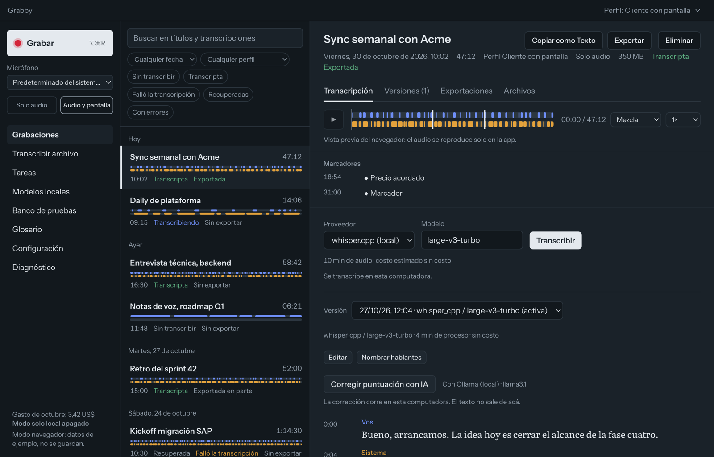
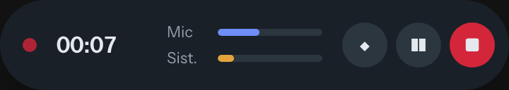
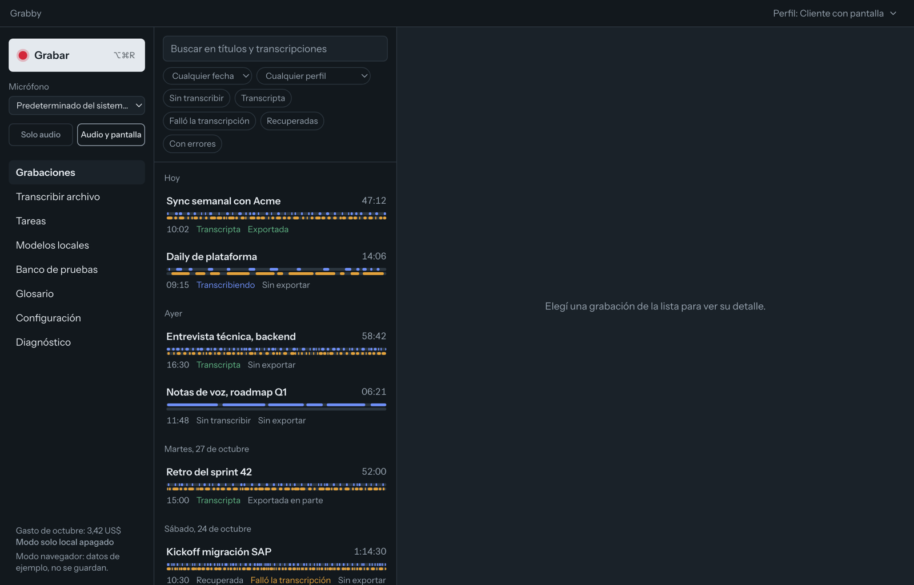

# Grabby

Grabby graba tus reuniones y las convierte en texto.

Graba tu micrófono y el audio de la llamada (Meet, Zoom, Teams o lo que suene en la
computadora) en pistas separadas, transcribe la grabación y te deja corregirla, buscarla y
exportarla.

## Qué hace

- **Graba en dos pistas.** Tu voz va por un lado y la de los demás por otro. Así la
  transcripción sabe quién habló y una pista no tapa a la otra.
- **Transcribe en tu computadora o en la nube.** Con el modelo local (Whisper) el audio no sale
  de tu máquina y no cuesta nada. Si preferís velocidad, podés usar Deepgram, AssemblyAI,
  OpenAI, Groq, ElevenLabs, Google o Azure con tu propia clave.
- **Marcadores.** Mientras grabás, un atajo de teclado (⌥⌘M) marca el momento importante ("acá se
  acordó el precio") para encontrarlo después.
- **Editor.** Corregís el texto mientras escuchás el audio, renombrás hablantes y unís o
  dividís frases. Cada cambio se guarda como una versión nueva; la original no se pierde.
- **Corrección con IA (opcional).** Arregla puntuación y mayúsculas sin resumir ni inventar.
  Puede correr local con Ollama.
- **Exporta** a Markdown, texto, PDF, Word, SRT, WebVTT o JSON, a una carpeta o a Google Drive.
- **Búsqueda.** Encontrás una reunión por título o por algo que se dijo.

Mientras grabás, una barra flotante muestra el tiempo y el nivel de cada pista, y deja pausar,
marcar o detener sin abrir la ventana:

## Privacidad

- Las grabaciones y las transcripciones quedan en tu computadora.
- El audio solo sale de tu máquina si elegís un proveedor en la nube, y la app lo marca antes de
  transcribir. El modo "solo local" bloquea cualquier servicio externo.
- Las claves de los proveedores se guardan en el Llavero del sistema, nunca en archivos.
- Antes de grabar, la app puede recordarte que avises a los participantes.

## Instalar

**Requisitos:** Mac con Apple Silicon (M1 o posterior) y macOS 14.4 o posterior.

1. Abrí [la última versión](../../releases/latest) y descargá `Grabby_<versión>_aarch64.dmg`.
2. Abrí el `.dmg` y arrastrá **Grabby** a **Aplicaciones**.
3. Abrí Grabby. macOS va a decir que no puede verificar la app: tocá **Listo**.
4. Andá a **Ajustes del Sistema → Privacidad y seguridad**, bajá hasta el aviso sobre Grabby y
   tocá **Abrir igual**. Te pide tu contraseña.
5. La primera vez que grabes, aceptá los permisos de **micrófono** y de **grabación de audio del
   sistema**.

El paso 4 aparece porque Grabby todavía no está firmada por Apple. Se hace una sola vez.

**Para transcribir sin conexión**, entrá a **Modelos locales** y descargá *Whisper large-v3-turbo*
(1,6 GB). Si no, configurá un proveedor en la nube en **Configuración → Proveedores y claves**.

## Actualizaciones

Grabby busca versiones nuevas al abrirse y se actualiza sola. También podés buscar a mano en
**Configuración → Actualizaciones**. Después de actualizar, macOS puede volver a pedir los
permisos de micrófono y audio del sistema.

## Windows

Todavía no. La versión para Windows está en desarrollo y va a aparecer en esta misma página.

---

Este repositorio solo tiene los instaladores. No borres los releases `updater-stable` y
`updater-beta`: las apps instaladas los leen para actualizarse.
